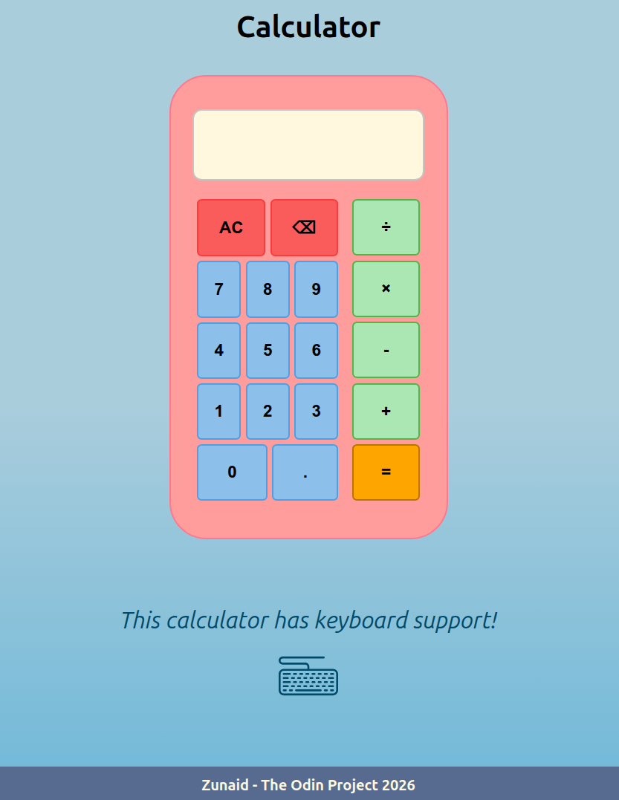

## The Odin Project: Calculator

### Links

Project link: https://www.theodinproject.com/lessons/foundations-calculator

Live preview: https://zunaid-hassan.github.io/odin-calculator/

### Description

A browser-based calculator built with vanilla HTML, CSS, and JavaScript. Supports basic arithmetic operations (addition, subtraction, multiplication, division), chained calculations, decimal input, and displays a snarky message on division by zero. Includes backspace functionality and full keyboard support. The calculator was styled as an ice-cream.

### Preview

